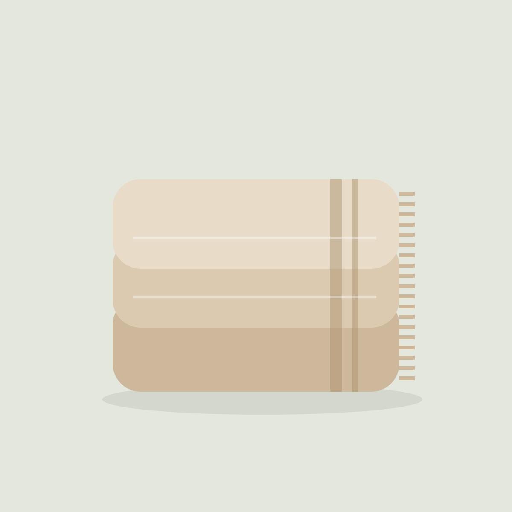
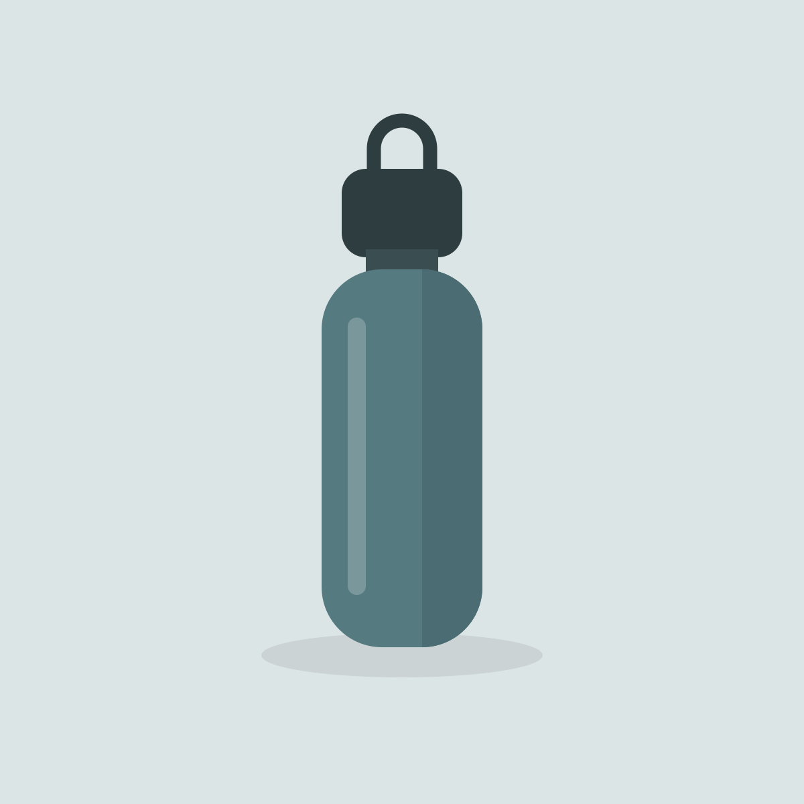
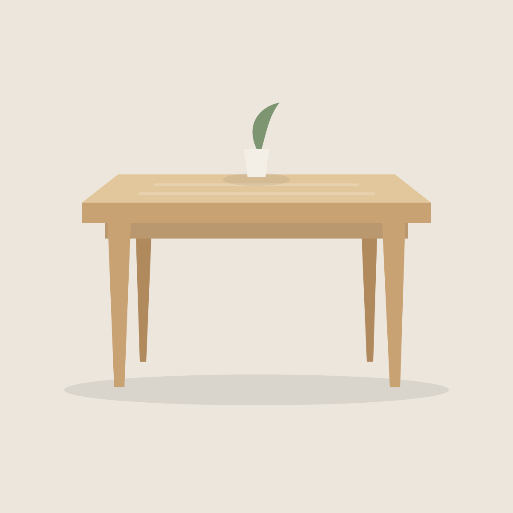
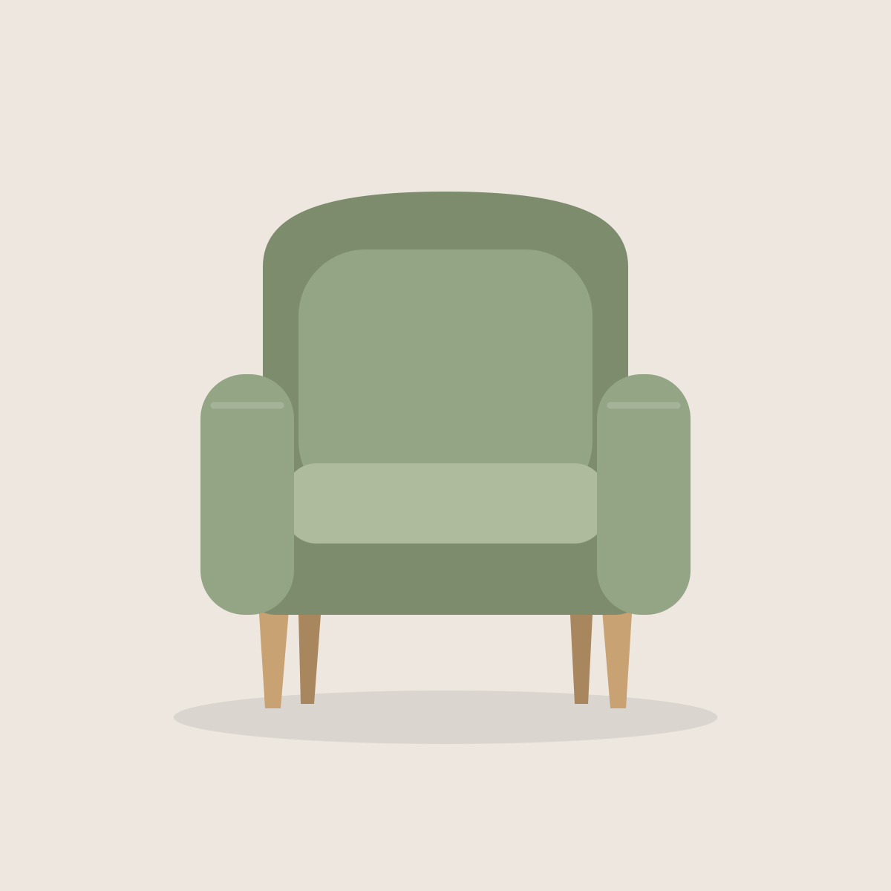
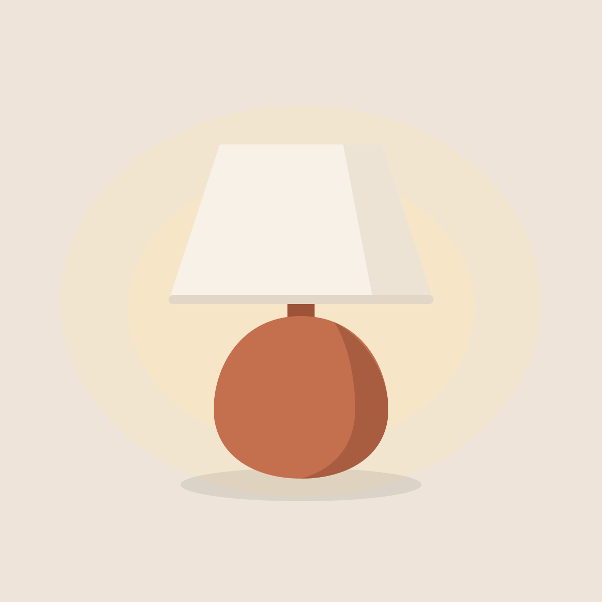

# Maison Claire: products for Shopify

Generated by `tools/make-shopify-sheet.py` from the same data as the demo store (`assets/catalog.js`) and the agent's knowledge base (`docs/kb-delivery.md`), so prices, sizes and delivery promises match what the voice agent says. Edit the script and re-run it rather than editing this file.

**Two ways to load the products**

- **Fastest:** Shopify Admin → **Products** → **Import** → upload [`products_import.csv`](products_import.csv). It creates all 8 products in English with price, cost, SKU, stock, weight, tags, SEO and images, including the 6 table and 8 armchair variants. Then add the few fields the CSV can't carry (category, collections, customs, French): see *After the import* below.

- **By hand:** Products → **Add product**, and copy each field from the product cards below. Descriptions are plain text: paste them straight into the description box (each line becomes its own paragraph).

Prices include VAT (see *Store settings*). Inventory quantities, cost prices, countries of origin and HS codes are realistic but invented for this demo store.

## Summary

| Product | Handle | SKU | Price | Cost | Stock | Shipping weight |
| --- | --- | --- | ---: | ---: | ---: | ---: |
| Ceramic Mug | `ceramic-mug` | `MC-MUG-350-WHT` | 18 € | 6.00 € | 120 | 0.55 kg |
| Vanilla Scented Candle | `vanilla-scented-candle` | `MC-CND-200-VAN` | 24 € | 8.00 € | 80 | 0.45 kg |
| Wool Blanket | `wool-blanket` | `MC-BLK-130170-BEI` | 79 € | 31.00 € | 25 | 1.2 kg |
| Insulated Bottle | `insulated-bottle` | `MC-BTL-500-BLU` | 29 € | 11.00 € | 60 | 0.45 kg |
| Solid Wood Dining Table | `solid-wood-dining-table` | 6 variants | 1890 to 2790 € | 760 to 1120 € | made to order | 54 to 78 kg |
| Lounge Armchair | `lounge-armchair` | 8 variants | 1290 to 1390 € | 520 to 560 € | 15 + made to order | 30 kg |
| Cotton Bath Towel | `cotton-bath-towel` | `MC-TWL-70140-WHT` | 25 € | 9.00 € | 70 | 0.65 kg |
| Table Lamp | `table-lamp` | `MC-LMP-40-TER` | 69 € | 26.00 € | 15 | 2.6 kg |

## 1. Ceramic Mug / Tasse en céramique


**Main fields** (Add product page, top to bottom)

| Field | Value |
| --- | --- |
| Title | Ceramic Mug |
| Description | plain text block below |
| Media | `shopify/images/maison-claire-mug.png`, alt text: White stoneware ceramic mug filled with coffee |
| Category | search **Mugs** (Home & Garden > Kitchen & Dining > Tableware > Drinkware > Mugs) |
| Price | 18.00 € |
| Compare-at price | leave empty (the agent's offer is the MERCI10 code) |
| Charge tax on this product | Yes |
| Cost per item | 6.00 € |
| Track quantity | Yes |
| Quantity | 120 |
| Continue selling when out of stock | No |
| SKU | MC-MUG-350-WHT |
| Barcode | leave empty |
| This is a physical product | Yes |
| Weight (with packaging) | 0.55 kg |
| Country/Region of origin | Portugal |
| HS code | 6912.00 |
| Variants | none (one version only) |
| Status | Active |
| Sales channels | Online Store |
| Type | Mugs |
| Vendor | Maison Claire |
| Collections | Kitchen & Table, Gifts under 30 € |
| Tags | ceramic, stoneware, kitchen, dishwasher safe, gift under 30 |
| Page title (SEO) | Ceramic Mug 350 ml, White Stoneware \| Maison Claire |
| Meta description (SEO) | A large white stoneware mug for coffee or tea, 350 ml. Microwave and dishwasher safe. Free delivery from 50 €. |
| URL handle | ceramic-mug |

**Description (English)**

```text
A generous everyday mug in soft white stoneware.

Made from glazed stoneware, a dense ceramic fired at high temperature, it is sturdy, keeps your drink warm for longer and resists chips better than ordinary earthenware. The smooth, rounded handle leaves room for three fingers, and the slightly thicker rim feels pleasant against the lips.

At 350 ml it holds a large coffee, a tea or a hot chocolate. The satin white glaze is free of lead and cadmium, and the mug goes straight into the microwave and the dishwasher. Each piece is glazed by hand, so small variations in tone are normal and make every mug unique.

Details
- Material: Stoneware ceramic, satin glaze (lead and cadmium free)
- Capacity: 350 ml
- Dimensions: 10 cm high, 9 cm across (12 cm with the handle)
- Weight: 380 g
- Colour: White
- Care: Dishwasher and microwave safe. Not for the oven or the hob.
- Made in: Portugal
- Packaging: Recycled cardboard box

Delivery and returns
Ships within 1 to 2 business days. Free delivery from 50 €, otherwise 5 €. Free returns within 30 days.
```

**French translation** (Settings → Languages → French → Translate, or the Translate & Adapt app)

| Field | Valeur |
| --- | --- |
| Title | Tasse en céramique |
| Page title (SEO) | Tasse en céramique 350 ml, grès blanc \| Maison Claire |
| Meta description (SEO) | Une grande tasse en grès blanc pour le café ou le thé, 350 ml. Micro-ondes et lave-vaisselle. Livraison offerte dès 50 €. |
| Image alt text | Tasse en grès blanc remplie de café |
| Type | Tasses |

**Description (français)**

```text
Une grande tasse du quotidien en grès blanc.

Fabriquée en grès émaillé, une céramique dense cuite à haute température, elle est robuste, garde votre boisson chaude plus longtemps et résiste mieux aux ébréchures que la faïence. Son anse douce et arrondie laisse la place à trois doigts, et son bord légèrement épais est agréable aux lèvres.

Avec ses 350 ml, elle accueille un grand café, un thé ou un chocolat chaud. L'émail blanc satiné est sans plomb ni cadmium, et la tasse passe au micro-ondes comme au lave-vaisselle. Chaque pièce est émaillée à la main : de légères variations de teinte sont normales et rendent chaque tasse unique.

Caractéristiques
- Matière : Grès céramique, émail satiné (sans plomb ni cadmium)
- Contenance : 350 ml
- Dimensions : 10 cm de haut, 9 cm de diamètre (12 cm avec l'anse)
- Poids : 380 g
- Couleur : Blanc
- Entretien : Lave-vaisselle et micro-ondes. Ne pas utiliser au four ni sur le feu.
- Fabriqué au : Portugal
- Emballage : Boîte en carton recyclé

Livraison et retours
Expédié sous 1 à 2 jours ouvrés. Livraison offerte dès 50 €, sinon 5 €. Retours gratuits sous 30 jours.
```

## 2. Vanilla Scented Candle / Bougie parfumée à la vanille


**Main fields** (Add product page, top to bottom)

| Field | Value |
| --- | --- |
| Title | Vanilla Scented Candle |
| Description | plain text block below |
| Media | `shopify/images/maison-claire-candle.png`, alt text: Vanilla candle in an amber glass jar, lit |
| Category | search **Candles** (Home & Garden > Decor > Home Fragrances > Candles) |
| Price | 24.00 € |
| Compare-at price | leave empty (the agent's offer is the MERCI10 code) |
| Charge tax on this product | Yes |
| Cost per item | 8.00 € |
| Track quantity | Yes |
| Quantity | 80 |
| Continue selling when out of stock | No |
| SKU | MC-CND-200-VAN |
| Barcode | leave empty |
| This is a physical product | Yes |
| Weight (with packaging) | 0.45 kg |
| Country/Region of origin | France |
| HS code | 3406.00 |
| Variants | none (one version only) |
| Status | Active |
| Sales channels | Online Store |
| Type | Candles |
| Vendor | Maison Claire |
| Collections | Home & Living, Gifts under 30 € |
| Tags | candle, vanilla, soy wax, home fragrance, gift under 30 |
| Page title (SEO) | Vanilla Scented Soy Candle, 40 Hours \| Maison Claire |
| Meta description (SEO) | Soy wax vanilla candle in an amber glass jar, about 40 hours of burn time. A gentle scent for the whole room. |
| URL handle | vanilla-scented-candle |

**Description (English)**

```text
A warm vanilla candle in an amber glass jar.

Poured by hand from natural soy wax with a cotton wick, it burns slowly and cleanly, with no paraffin and very little smoke. The scent is a soft, rounded vanilla with a hint of tonka bean: enough to fill a living room without ever being overpowering.

The 200 g of wax give about 40 hours of burning. Once the candle is finished, the amber glass jar can be washed and reused for pens, cotton pads or a small plant.

For the best result, let the wax melt across the whole surface on the first burn (about 2 hours), trim the wick to 5 mm before each use, and never leave a lit candle unattended.

Details
- Wax: Natural soy wax, paraffin free, vegan
- Wick: Cotton
- Scent: Vanilla with a hint of tonka bean
- Net wax weight: 200 g
- Burn time: About 40 hours
- Jar: Amber glass, reusable, 8 cm across, 9 cm high
- Safety: Burn for 3 hours at most at a time, away from draughts, children and pets
- Made in: France

Delivery and returns
Ships within 1 to 2 business days. Free delivery from 50 €, otherwise 5 €. Free returns within 30 days.
```

**French translation** (Settings → Languages → French → Translate, or the Translate & Adapt app)

| Field | Valeur |
| --- | --- |
| Title | Bougie parfumée à la vanille |
| Page title (SEO) | Bougie parfumée vanille, cire de soja, 40 h \| Maison Claire |
| Meta description (SEO) | Bougie à la vanille en cire de soja dans un pot en verre ambré, environ 40 heures de combustion. Un parfum doux pour toute la pièce. |
| Image alt text | Bougie à la vanille allumée dans un pot en verre ambré |
| Type | Bougies |

**Description (français)**

```text
Une bougie à la vanille dans un pot en verre ambré.

Coulée à la main en cire de soja naturelle avec une mèche en coton, elle brûle lentement et proprement, sans paraffine et avec très peu de fumée. Son parfum est une vanille douce et ronde, avec une pointe de fève tonka : de quoi embaumer un salon sans jamais être trop fort.

Ses 200 g de cire offrent environ 40 heures de combustion. Une fois la bougie terminée, le pot en verre ambré se lave et se réutilise pour des crayons, des cotons ou une petite plante.

Pour un résultat optimal, laissez la cire fondre sur toute la surface lors du premier allumage (environ 2 heures), coupez la mèche à 5 mm avant chaque utilisation et ne laissez jamais une bougie allumée sans surveillance.

Caractéristiques
- Cire : Cire de soja naturelle, sans paraffine, vegan
- Mèche : Coton
- Parfum : Vanille, pointe de fève tonka
- Poids net de cire : 200 g
- Durée de combustion : Environ 40 heures
- Pot : Verre ambré réutilisable, 8 cm de diamètre, 9 cm de haut
- Sécurité : 3 heures maximum d'affilée, à l'abri des courants d'air, des enfants et des animaux
- Fabriqué en : France

Livraison et retours
Expédié sous 1 à 2 jours ouvrés. Livraison offerte dès 50 €, sinon 5 €. Retours gratuits sous 30 jours.
```

## 3. Wool Blanket / Plaid en laine



**Main fields** (Add product page, top to bottom)

| Field | Value |
| --- | --- |
| Title | Wool Blanket |
| Description | plain text block below |
| Media | `shopify/images/maison-claire-blanket.png`, alt text: Folded natural beige wool blanket with a stripe |
| Category | search **Blankets** (Home & Garden > Linens & Bedding > Bedding > Blankets) |
| Price | 79.00 € |
| Compare-at price | leave empty (the agent's offer is the MERCI10 code) |
| Charge tax on this product | Yes |
| Cost per item | 31.00 € |
| Track quantity | Yes |
| Quantity | 25 |
| Continue selling when out of stock | No |
| SKU | MC-BLK-130170-BEI |
| Barcode | leave empty |
| This is a physical product | Yes |
| Weight (with packaging) | 1.2 kg |
| Country/Region of origin | Portugal |
| HS code | 6301.20 |
| Variants | none (one version only) |
| Status | Active |
| Sales channels | Online Store |
| Type | Blankets |
| Vendor | Maison Claire |
| Collections | Home & Living |
| Tags | wool, blanket, throw, living room, bedroom |
| Page title (SEO) | Pure Wool Blanket 130 × 170 cm, Natural Beige \| Maison Claire |
| Meta description (SEO) | A soft, warm pure wool blanket with fringed edges, 130 × 170 cm, for the sofa or the bed. Free delivery from 50 €. |
| URL handle | wool-blanket |

**Description (English)**

```text
A soft, warm blanket for the sofa or the bed.

Woven from pure new wool in a natural beige colour, with a simple stripe near one edge and knotted fringes at both ends. The wool is lightly brushed after weaving, which makes it soft to the touch while keeping the natural warmth and texture of the fibre.

Wool regulates temperature on its own: it keeps you warm on winter evenings and stays breathable the rest of the year. Throw it over the sofa, fold it at the foot of the bed or take it along for picnics. A few fibres may come loose during the first uses; this is normal for pure wool and stops quickly.

Details
- Material: 100% pure new wool
- Size: 130 × 170 cm (fringes not included)
- Fringes: 8 cm, knotted, at both short ends
- Weight: About 900 g
- Colour: Natural beige with a single stripe
- Care: Hand wash cold with a wool detergent, dry flat. No tumble dryer. Air it regularly between washes.
- Made in: Portugal
- Packaging: Cotton dust bag

Delivery and returns
Ships within 1 to 2 business days. Free delivery from 50 €, otherwise 5 €. Free returns within 30 days.
```

**French translation** (Settings → Languages → French → Translate, or the Translate & Adapt app)

| Field | Valeur |
| --- | --- |
| Title | Plaid en laine |
| Page title (SEO) | Plaid en pure laine 130 × 170 cm, beige naturel \| Maison Claire |
| Meta description (SEO) | Un plaid doux et chaud en pure laine avec franges, 130 × 170 cm, pour le canapé ou le lit. Livraison offerte dès 50 €. |
| Image alt text | Plaid en laine beige naturel plié, avec une rayure |
| Type | Plaids |

**Description (français)**

```text
Un plaid doux et chaud pour le canapé ou le lit.

Tissé en pure laine vierge beige naturel, avec une rayure simple près d'un bord et des franges nouées aux deux extrémités. La laine est légèrement grattée après le tissage, ce qui la rend douce au toucher tout en gardant la chaleur et la texture naturelles de la fibre.

La laine régule naturellement la température : elle vous tient chaud les soirs d'hiver et reste respirante le reste de l'année. Jetez-le sur le canapé, pliez-le au pied du lit ou emportez-le en pique-nique. Quelques fibres peuvent se détacher lors des premières utilisations : c'est normal pour une pure laine et cela cesse rapidement.

Caractéristiques
- Matière : 100 % pure laine vierge
- Dimensions : 130 × 170 cm (hors franges)
- Franges : 8 cm, nouées, sur les deux petits côtés
- Poids : Environ 900 g
- Couleur : Beige naturel avec une rayure
- Entretien : Lavage à la main à froid avec une lessive spéciale laine, séchage à plat. Pas de sèche-linge. Aérer régulièrement entre deux lavages.
- Fabriqué au : Portugal
- Emballage : Housse en coton

Livraison et retours
Expédié sous 1 à 2 jours ouvrés. Livraison offerte dès 50 €, sinon 5 €. Retours gratuits sous 30 jours.
```

## 4. Insulated Bottle / Gourde isotherme



**Main fields** (Add product page, top to bottom)

| Field | Value |
| --- | --- |
| Title | Insulated Bottle |
| Description | plain text block below |
| Media | `shopify/images/maison-claire-bottle.png`, alt text: Slate blue insulated stainless steel bottle |
| Category | search **Water Bottles** (Home & Garden > Kitchen & Dining > Food & Beverage Carriers > Water Bottles) |
| Price | 29.00 € |
| Compare-at price | leave empty (the agent's offer is the MERCI10 code) |
| Charge tax on this product | Yes |
| Cost per item | 11.00 € |
| Track quantity | Yes |
| Quantity | 60 |
| Continue selling when out of stock | No |
| SKU | MC-BTL-500-BLU |
| Barcode | leave empty |
| This is a physical product | Yes |
| Weight (with packaging) | 0.45 kg |
| Country/Region of origin | China |
| HS code | 9617.00 |
| Variants | none (one version only) |
| Status | Active |
| Sales channels | Online Store |
| Type | Water bottles |
| Vendor | Maison Claire |
| Collections | Kitchen & Table, Gifts under 30 € |
| Tags | bottle, stainless steel, insulated, on the go, gift under 30 |
| Page title (SEO) | Insulated Stainless Steel Bottle 500 ml \| Maison Claire |
| Meta description (SEO) | Leak proof 500 ml stainless steel bottle in slate blue. Keeps drinks cold for 24 hours or hot for 12. |
| URL handle | insulated-bottle |

**Description (English)**

```text
Keeps drinks cold for 24 hours or hot for 12.

Its double wall of food-grade stainless steel is vacuum insulated: the outside stays at room temperature, without condensation, whatever you put inside. Iced water stays cold through a whole summer day, and tea or coffee stays hot until the afternoon.

The leak proof screw cap has a built-in carry loop, so you can hang it on a bag or carry it on one finger. At 7 cm across it fits most car and bike cup holders, and the wide opening takes ice cubes and is easy to clean. The slate blue finish is a matte powder coating that does not slip in the hand and resists scratches.

Details
- Material: 18/8 food-grade stainless steel, double wall, vacuum insulated
- Cap: Leak proof screw cap with carry loop, BPA free
- Capacity: 500 ml
- Keeps: Cold 24 hours, hot 12 hours
- Dimensions: 26 cm high, 7 cm across
- Weight: 340 g (empty)
- Colour: Slate blue, matte powder coating
- Care: Hand wash only. Not for the dishwasher, freezer or microwave.
- Made in: China

Delivery and returns
Ships within 1 to 2 business days. Free delivery from 50 €, otherwise 5 €. Free returns within 30 days.
```

**French translation** (Settings → Languages → French → Translate, or the Translate & Adapt app)

| Field | Valeur |
| --- | --- |
| Title | Gourde isotherme |
| Page title (SEO) | Gourde isotherme inox 500 ml, bleu ardoise \| Maison Claire |
| Meta description (SEO) | Gourde étanche en acier inoxydable 500 ml, bleu ardoise. Garde vos boissons froides 24 h ou chaudes 12 h. |
| Image alt text | Gourde isotherme en acier inoxydable bleu ardoise |
| Type | Gourdes |

**Description (français)**

```text
Garde vos boissons froides 24 h ou chaudes 12 h.

Sa double paroi en acier inoxydable alimentaire est isolée sous vide : l'extérieur reste à température ambiante, sans condensation, quelle que soit la boisson. L'eau glacée reste fraîche toute une journée d'été, et le thé ou le café reste chaud jusqu'à l'après-midi.

Le bouchon à visser étanche intègre une anse de transport : accrochez la gourde à un sac ou portez-la d'un doigt. Avec ses 7 cm de diamètre, elle se glisse dans la plupart des porte-gobelets de voiture et de vélo, et son large goulot accepte les glaçons et se nettoie facilement. La finition bleu ardoise est un revêtement mat par poudrage, qui ne glisse pas dans la main et résiste aux rayures.

Caractéristiques
- Matière : Acier inoxydable alimentaire 18/8, double paroi, isolation sous vide
- Bouchon : À visser, étanche, avec anse de transport, sans BPA
- Contenance : 500 ml
- Conservation : Froid 24 heures, chaud 12 heures
- Dimensions : 26 cm de haut, 7 cm de diamètre
- Poids : 340 g (à vide)
- Couleur : Bleu ardoise, revêtement mat par poudrage
- Entretien : Lavage à la main uniquement. Pas de lave-vaisselle, de congélateur ni de micro-ondes.
- Fabriqué en : Chine

Livraison et retours
Expédié sous 1 à 2 jours ouvrés. Livraison offerte dès 50 €, sinon 5 €. Retours gratuits sous 30 jours.
```

## 5. Solid Wood Dining Table / Table à manger en bois massif



**Main fields** (Add product page, top to bottom)

| Field | Value |
| --- | --- |
| Title | Solid Wood Dining Table |
| Description | plain text block below |
| Media | 3 images, `shopify/images/maison-claire-table-*.png` (one per variant colour, see the variants table) |
| Category | search **Kitchen & Dining Room Tables** (Furniture > Tables > Kitchen & Dining Room Tables) |
| Price | set per variant (table below) |
| Compare-at price | leave empty (the agent's offer is the MERCI10 code) |
| Charge tax on this product | Yes |
| Cost per item | set per variant |
| Inventory | Made to order: don't track quantity |
| SKU | set per variant |
| This is a physical product | Yes |
| Weight (with packaging) | set per variant |
| Shipping profile | Furniture (see Shipping below) |
| Country/Region of origin | France |
| HS code | 9403.60 |
| Variants | two options, see the variants table below |
| Status | Active |
| Sales channels | Online Store |
| Type | Dining tables |
| Vendor | Maison Claire |
| Collections | Furniture, Kitchen & Table |
| Tags | furniture, dining table, solid wood, oak, walnut, made to order |
| Page title (SEO) | Solid Oak or Walnut Dining Table, Made to Order \| Maison Claire |
| Meta description (SEO) | Solid oak or walnut dining table for 6 or 8 people, made to order in France. Free two-person delivery to the room of your choice. |
| URL handle | solid-wood-dining-table |

**Variants** (Variants → Add options: *Wood* with Natural oak, Smoked oak, Walnut; *Size* with 180 × 90 cm, 220 × 100 cm. Then fill each row)

| Wood | Size | SKU | Price | Cost | Inventory | Weight | Image |
| --- | --- | --- | ---: | ---: | --- | ---: | --- |
| Natural oak | 180 × 90 cm | `MC-TBL-OAK-180` | 1890 € | 760 € | not tracked | 60 kg | `table-oak` |
| Natural oak | 220 × 100 cm | `MC-TBL-OAK-220` | 2290 € | 920 € | not tracked | 78 kg | `table-oak` |
| Smoked oak | 180 × 90 cm | `MC-TBL-SMK-180` | 2040 € | 820 € | not tracked | 60 kg | `table-smoked` |
| Smoked oak | 220 × 100 cm | `MC-TBL-SMK-220` | 2440 € | 980 € | not tracked | 78 kg | `table-smoked` |
| Walnut | 180 × 90 cm | `MC-TBL-WAL-180` | 2390 € | 960 € | not tracked | 54 kg | `table-walnut` |
| Walnut | 220 × 100 cm | `MC-TBL-WAL-220` | 2790 € | 1120 € | not tracked | 70 kg | `table-walnut` |

Image alt texts: `table-oak`: Natural oak dining table; `table-smoked`: Smoked oak dining table; `table-walnut`: Walnut dining table

**Description (English)**

```text
A made-to-order dining table in solid oak or walnut, for 6 or 8 people.

Built to last for generations in our partner workshop in the Jura mountains in France. The top is made of solid wood boards 4 cm thick, joined edge to edge and finished by hand, with softly rounded edges and four tapered legs set 8 cm in from the corners, so a chair fits at each end.

Choose natural oak for a light honey tone, smoked oak, darkened all the way through by a traditional fuming process rather than a stain, or American black walnut for a deep chocolate brown. Every table is unique: the grain, knots and colour vary from one board to the next.

The matte hard-wax oil finish is food safe and easy to repair: light scratches and water rings can be sanded and re-oiled with the care kit included. Our two-person delivery team carries it to the room of your choice and bolts on the legs for you. Chairs are not included.

Details
- Wood: Solid European oak from French forests (natural or smoked), or solid American black walnut, FSC certified
- Sizes: 180 × 90 cm (seats 6) or 220 × 100 cm (seats 8)
- Height: 75 cm, with 66 cm of knee room under the frame. Suits chairs with a 44 to 48 cm seat
- Tabletop: Solid boards, 4 cm thick, rounded edges
- Weight: 180 cm: 52 kg in oak, 46 kg in walnut. 220 cm: 68 kg in oak, 60 kg in walnut
- Maximum load: 120 kg, evenly spread
- Finish: Matte hard-wax oil, food safe
- Assembly: Legs bolt on. Free assembly by our delivery team, or 20 minutes for two people with the Allen key included
- Packaging: Top in a flat box (190 × 100 × 12 cm or 230 × 110 × 12 cm), legs in a second box. Fits through an 80 cm door
- Care: Damp cloth, coasters and trivets. Re-oil once a year with the care kit included. Keep 50 cm from radiators. Indoor use only
- Lead time: Made to order: 6 to 8 weeks in oak, 8 to 10 weeks in walnut
- Made in: France (Jura)
- Warranty: 10 years on the structure and joints

Delivery and returns
Free two-person delivery to the room of your choice, on any floor. When your piece is ready, our delivery partner calls you to book a day and a 4-hour slot, Monday to Saturday. Free returns within 30 days of delivery: we collect it from your home.
```

**French translation** (Settings → Languages → French → Translate, or the Translate & Adapt app)

| Field | Valeur |
| --- | --- |
| Title | Table à manger en bois massif |
| Page title (SEO) | Table à manger en chêne ou noyer massif \| Maison Claire |
| Meta description (SEO) | Table à manger en chêne ou noyer massif pour 6 ou 8 personnes, fabriquée en France. Livraison offerte par deux livreurs. |
| Image alt text | Table à manger en bois massif à quatre pieds fuselés |
| Type | Tables à manger |
| Option Wood | Bois: Natural oak → Chêne naturel, Smoked oak → Chêne fumé, Walnut → Noyer |
| Option Size | Dimensions:  |

**Description (français)**

```text
Une table à manger fabriquée à la commande en chêne ou noyer massif, pour 6 ou 8 personnes.

Conçue pour traverser les générations dans notre atelier partenaire du Jura. Le plateau est composé de planches de bois massif de 4 cm d'épaisseur, assemblées à chant et finies à la main, avec des bords adoucis et quatre pieds fuselés placés à 8 cm des angles, pour qu'une chaise tienne à chaque bout.

Choisissez le chêne naturel pour une teinte miel lumineuse, le chêne fumé, foncé dans toute son épaisseur par un fumage traditionnel et non par une teinture, ou le noyer noir d'Amérique pour un brun chocolat profond. Chaque table est unique : le fil du bois, les nœuds et la couleur varient d'une planche à l'autre.

La finition à l'huile-cire mate est compatible avec le contact alimentaire et facile à rénover : rayures légères et auréoles se poncent et se huilent à nouveau avec le kit d'entretien fourni. Nos deux livreurs l'installent dans la pièce de votre choix et fixent les pieds pour vous. Chaises non incluses.

Caractéristiques
- Bois : Chêne massif européen de forêts françaises (naturel ou fumé), ou noyer noir d'Amérique massif, certifié FSC
- Dimensions : 180 × 90 cm (6 personnes) ou 220 × 100 cm (8 personnes)
- Hauteur : 75 cm, dont 66 cm de passage pour les jambes. Pour des chaises de 44 à 48 cm d'assise
- Plateau : Planches massives de 4 cm d'épaisseur, bords adoucis
- Poids : 180 cm : 52 kg en chêne, 46 kg en noyer. 220 cm : 68 kg en chêne, 60 kg en noyer
- Charge maximale : 120 kg répartis
- Finition : Huile-cire mate, contact alimentaire
- Montage : Pieds vissés. Montage offert par nos livreurs, ou 20 minutes à deux avec la clé Allen fournie
- Emballage : Plateau dans un carton plat (190 × 100 × 12 cm ou 230 × 110 × 12 cm), pieds dans un second carton. Passe par une porte de 80 cm
- Entretien : Chiffon humide, sous-verres et dessous-de-plat. Huiler une fois par an avec le kit fourni. À 50 cm des radiateurs. Usage intérieur
- Délai : Fabriquée à la commande : 6 à 8 semaines en chêne, 8 à 10 semaines en noyer
- Fabriquée en : France (Jura)
- Garantie : 10 ans sur la structure et les assemblages

Livraison et retours
Livraison offerte par deux livreurs jusqu'à la pièce de votre choix, à n'importe quel étage. Quand votre meuble est prêt, notre transporteur vous appelle pour fixer un jour et un créneau de 4 heures, du lundi au samedi. Retours gratuits sous 30 jours après la livraison : nous venons le chercher chez vous.
```

## 6. Lounge Armchair / Fauteuil de salon



**Main fields** (Add product page, top to bottom)

| Field | Value |
| --- | --- |
| Title | Lounge Armchair |
| Description | plain text block below |
| Media | 8 images, `shopify/images/maison-claire-armchair-*.png` (one per variant colour, see the variants table) |
| Category | search **Arm Chairs, Recliners & Sleeper Chairs** (Furniture > Chairs > Arm Chairs, Recliners & Sleeper Chairs) |
| Price | set per variant (table below) |
| Compare-at price | leave empty (the agent's offer is the MERCI10 code) |
| Charge tax on this product | Yes |
| Cost per item | set per variant |
| Inventory | Track quantity. Terracotta and midnight blue: 0 in stock with *Continue selling when out of stock* on (made to order) |
| SKU | set per variant |
| This is a physical product | Yes |
| Weight (with packaging) | set per variant |
| Shipping profile | Furniture (see Shipping below) |
| Country/Region of origin | Portugal |
| HS code | 9401.61 |
| Variants | two options, see the variants table below |
| Status | Active |
| Sales channels | Online Store |
| Type | Armchairs |
| Vendor | Maison Claire |
| Collections | Furniture, Home & Living |
| Tags | furniture, armchair, velvet, boucle, living room |
| Page title (SEO) | Lounge Armchair in Velvet or Wool Bouclé \| Maison Claire |
| Meta description (SEO) | A deep lounge armchair in cotton velvet or wool bouclé, on solid oak legs. Arrives assembled, with free two-person delivery. |
| URL handle | lounge-armchair |

**Variants** (Variants → Add options: *Fabric* with Sage green velvet, Terracotta velvet, Midnight blue velvet, Ivory wool bouclé; *Legs* with Natural oak, Black-stained oak. Then fill each row)

| Fabric | Legs | SKU | Price | Cost | Inventory | Weight | Image |
| --- | --- | --- | ---: | ---: | --- | ---: | --- |
| Sage green velvet | Natural oak | `MC-ARM-SAG-OAK` | 1290 € | 520 € | 6 | 30 kg | `armchair-sage-oak` |
| Sage green velvet | Black-stained oak | `MC-ARM-SAG-BLK` | 1290 € | 520 € | 3 | 30 kg | `armchair-sage-black` |
| Terracotta velvet | Natural oak | `MC-ARM-TER-OAK` | 1290 € | 520 € | 0, keep selling | 30 kg | `armchair-terracotta-oak` |
| Terracotta velvet | Black-stained oak | `MC-ARM-TER-BLK` | 1290 € | 520 € | 0, keep selling | 30 kg | `armchair-terracotta-black` |
| Midnight blue velvet | Natural oak | `MC-ARM-MID-OAK` | 1290 € | 520 € | 0, keep selling | 30 kg | `armchair-midnight-oak` |
| Midnight blue velvet | Black-stained oak | `MC-ARM-MID-BLK` | 1290 € | 520 € | 0, keep selling | 30 kg | `armchair-midnight-black` |
| Ivory wool bouclé | Natural oak | `MC-ARM-IVO-OAK` | 1390 € | 560 € | 4 | 30 kg | `armchair-ivory-oak` |
| Ivory wool bouclé | Black-stained oak | `MC-ARM-IVO-BLK` | 1390 € | 560 € | 2 | 30 kg | `armchair-ivory-black` |

Image alt texts: `armchair-sage-oak`: Sage green velvet armchair on natural oak legs; `armchair-sage-black`: Sage green velvet armchair on black oak legs; `armchair-terracotta-oak`: Terracotta velvet armchair on natural oak legs; `armchair-terracotta-black`: Terracotta velvet armchair on black oak legs; `armchair-midnight-oak`: Midnight blue velvet armchair on natural oak legs; `armchair-midnight-black`: Midnight blue velvet armchair on black oak legs; `armchair-ivory-oak`: Ivory wool bouclé armchair on natural oak legs; `armchair-ivory-black`: Ivory wool bouclé armchair on black oak legs

**Description (English)**

```text
A deep armchair in cotton velvet or wool bouclé, on solid oak legs.

A generous armchair with a gently curved back and wide arms, made for long evenings with a book. The kiln-dried solid beech frame is built to last, the seat combines pocket springs with high-resilience foam so it keeps its shape, and the loose back cushion is filled with a soft mix of recycled duck feather and fibre.

Choose a cotton velvet in sage green, terracotta or midnight blue, or an ivory wool bouclé with a soft looped texture. The legs are solid oak, natural or stained black. If you have a cat or a dog, we recommend velvet, as claws can catch in the bouclé loops.

It arrives fully assembled: just screw on the four legs by hand, no tools needed. Without its legs it is 62 cm high, so it goes through a 65 cm doorway turned on its back. Sage green and ivory are in stock; terracotta and midnight blue are made to order.

Details
- Fabric: Cotton velvet (88% cotton, 12% polyester, 40,000 rubs) or wool bouclé (65% wool, 35% polyamide, 30,000 rubs)
- Legs: Solid oak, natural or black-stained
- Dimensions: 78 cm wide, 84 cm deep, 76 cm high
- Seat: 42 cm high, 55 cm deep, medium firm. Arms 58 cm high
- Weight: 24 kg. Supports up to 130 kg
- Frame: Kiln-dried solid beech
- Filling: Pocket springs and high-resilience foam. Back cushion: 50% recycled duck feather, 50% polyester fibre (no feather-free version)
- Fire safety: EN 1021 parts 1 and 2
- Assembly: Arrives assembled. Screw on the 4 legs by hand. Box 84 × 90 × 82 cm
- Care: Covers are not removable. Vacuum with a soft brush, dab spills with a damp cloth. Keep out of strong sunlight
- Lead time: Sage green and ivory: in stock, 1 to 2 weeks. Terracotta and midnight blue: made to order, 4 to 5 weeks
- Made in: Portugal
- Warranty: 10 years on the frame, 2 years on fabric, springs and cushions

Delivery and returns
Free two-person delivery to the room of your choice, on any floor. When your piece is ready, our delivery partner calls you to book a day and a 4-hour slot, Monday to Saturday. Free returns within 30 days of delivery: we collect it from your home.
```

**French translation** (Settings → Languages → French → Translate, or the Translate & Adapt app)

| Field | Valeur |
| --- | --- |
| Title | Fauteuil de salon |
| Page title (SEO) | Fauteuil de salon en velours ou bouclette \| Maison Claire |
| Meta description (SEO) | Un fauteuil profond en velours de coton ou bouclette de laine, sur pieds en chêne massif. Livré monté, livraison offerte. |
| Image alt text | Fauteuil de salon en velours vert sauge sur pieds en chêne |
| Type | Fauteuils |
| Option Fabric | Tissu: Sage green velvet → Velours vert sauge, Terracotta velvet → Velours terracotta, Midnight blue velvet → Velours bleu nuit, Ivory wool bouclé → Bouclette de laine ivoire |
| Option Legs | Pieds: Natural oak → Chêne naturel, Black-stained oak → Chêne teinté noir |

**Description (français)**

```text
Un fauteuil profond en velours de coton ou bouclette de laine, sur pieds en chêne massif.

Un fauteuil généreux, au dossier légèrement arrondi et aux larges accoudoirs, pensé pour les longues soirées de lecture. La structure en hêtre massif séché au four est faite pour durer, l'assise associe ressorts ensachés et mousse haute résilience pour garder sa forme, et le coussin de dossier amovible est garni d'un doux mélange de plumes de canard recyclées et de fibres.

Choisissez un velours de coton vert sauge, terracotta ou bleu nuit, ou une bouclette de laine ivoire à la texture moelleuse. Les pieds sont en chêne massif, naturel ou teinté noir. Si vous avez un chat ou un chien, nous conseillons le velours : les griffes peuvent accrocher les boucles de la bouclette.

Il est livré entièrement monté : il suffit de visser les quatre pieds à la main, sans outil. Sans ses pieds, il mesure 62 cm de haut et passe, couché sur le dos, par une porte de 65 cm. Vert sauge et ivoire sont en stock ; terracotta et bleu nuit sont fabriqués à la commande.

Caractéristiques
- Tissu : Velours de coton (88 % coton, 12 % polyester, 40 000 frottements) ou bouclette de laine (65 % laine, 35 % polyamide, 30 000 frottements)
- Pieds : Chêne massif, naturel ou teinté noir
- Dimensions : 78 cm de large, 84 cm de profondeur, 76 cm de haut
- Assise : 42 cm de haut, 55 cm de profondeur, confort mi-ferme. Accoudoirs à 58 cm
- Poids : 24 kg. Supporte jusqu'à 130 kg
- Structure : Hêtre massif séché au four
- Garnissage : Ressorts ensachés et mousse haute résilience. Coussin de dossier : 50 % plumes de canard recyclées, 50 % fibres de polyester (pas de version sans plumes)
- Sécurité incendie : EN 1021 parties 1 et 2
- Montage : Livré monté. Vissez les 4 pieds à la main. Carton de 84 × 90 × 82 cm
- Entretien : Housses non déhoussables. Aspirer avec une brosse souple, tamponner les taches avec un chiffon humide. Éviter le plein soleil
- Délai : Vert sauge et ivoire : en stock, 1 à 2 semaines. Terracotta et bleu nuit : fabriqué à la commande, 4 à 5 semaines
- Fabriqué au : Portugal
- Garantie : 10 ans sur la structure, 2 ans sur le tissu, les ressorts et les coussins

Livraison et retours
Livraison offerte par deux livreurs jusqu'à la pièce de votre choix, à n'importe quel étage. Quand votre meuble est prêt, notre transporteur vous appelle pour fixer un jour et un créneau de 4 heures, du lundi au samedi. Retours gratuits sous 30 jours après la livraison : nous venons le chercher chez vous.
```

## 7. Cotton Bath Towel / Serviette de bain en coton


**Main fields** (Add product page, top to bottom)

| Field | Value |
| --- | --- |
| Title | Cotton Bath Towel |
| Description | plain text block below |
| Media | `shopify/images/maison-claire-towel.png`, alt text: Folded white cotton bath towels |
| Category | search **Bath Towels & Washcloths** (Home & Garden > Linens & Bedding > Towels > Bath Towels & Washcloths) |
| Price | 25.00 € |
| Compare-at price | leave empty (the agent's offer is the MERCI10 code) |
| Charge tax on this product | Yes |
| Cost per item | 9.00 € |
| Track quantity | Yes |
| Quantity | 70 |
| Continue selling when out of stock | No |
| SKU | MC-TWL-70140-WHT |
| Barcode | leave empty |
| This is a physical product | Yes |
| Weight (with packaging) | 0.65 kg |
| Country/Region of origin | Portugal |
| HS code | 6302.60 |
| Variants | none (one version only) |
| Status | Active |
| Sales channels | Online Store |
| Type | Bath towels |
| Vendor | Maison Claire |
| Collections | Bath, Gifts under 30 € |
| Tags | towel, cotton, bathroom, gift under 30 |
| Page title (SEO) | White Cotton Bath Towel 70 × 140 cm \| Maison Claire |
| Meta description (SEO) | A thick, absorbent 100% cotton bath towel, 70 × 140 cm, that gets softer with every wash. |
| URL handle | cotton-bath-towel |

**Description (English)**

```text
A thick, absorbent towel in soft white cotton.

Woven from long-staple cotton in a dense 550 g/m² terry, it dries you quickly and gets softer with every wash. At 70 × 140 cm it is large enough to wrap around you after a shower.

Double-stitched hems keep the edges neat wash after wash, and a hanging loop lets you hang it on a hook. Wash it once before the first use: this removes the finishing from the factory and brings out its full absorbency.

Details
- Material: 100% long-staple cotton terry, 550 g/m²
- Size: 70 × 140 cm
- Colour: White
- Finish: Double-stitched hems, hanging loop
- Care: Machine wash 40 °C (60 °C possible). Tumble dry low. No fabric softener, which reduces absorbency.
- Made in: Portugal

Delivery and returns
Ships within 1 to 2 business days. Free delivery from 50 €, otherwise 5 €. Free returns within 30 days.
```

**French translation** (Settings → Languages → French → Translate, or the Translate & Adapt app)

| Field | Valeur |
| --- | --- |
| Title | Serviette de bain en coton |
| Page title (SEO) | Serviette de bain en coton blanc 70 × 140 cm \| Maison Claire |
| Meta description (SEO) | Une serviette de bain épaisse et absorbante, 100 % coton, 70 × 140 cm, plus douce à chaque lavage. |
| Image alt text | Serviettes de bain en coton blanc pliées |
| Type | Serviettes de bain |

**Description (français)**

```text
Une serviette épaisse et absorbante en coton blanc.

Tissée en coton à fibres longues dans une éponge dense de 550 g/m², elle sèche rapidement et devient plus douce à chaque lavage. Avec ses 70 × 140 cm, elle est assez grande pour s'envelopper après la douche.

Ses ourlets à double piqûre restent nets lavage après lavage, et une bride permet de la suspendre à une patère. Lavez-la une fois avant la première utilisation : cela retire l'apprêt d'usine et révèle tout son pouvoir absorbant.

Caractéristiques
- Matière : Éponge 100 % coton à fibres longues, 550 g/m²
- Dimensions : 70 × 140 cm
- Couleur : Blanc
- Finitions : Ourlets à double piqûre, bride de suspension
- Entretien : Machine à 40 °C (60 °C possible). Sèche-linge à basse température. Pas d'adoucissant, qui réduit l'absorption.
- Fabriqué au : Portugal

Livraison et retours
Expédié sous 1 à 2 jours ouvrés. Livraison offerte dès 50 €, sinon 5 €. Retours gratuits sous 30 jours.
```

## 8. Table Lamp / Lampe de table



**Main fields** (Add product page, top to bottom)

| Field | Value |
| --- | --- |
| Title | Table Lamp |
| Description | plain text block below |
| Media | `shopify/images/maison-claire-lamp.png`, alt text: Terracotta ceramic table lamp with a linen shade |
| Category | search **Lamps** (Home & Garden > Lighting > Lamps) |
| Price | 69.00 € |
| Compare-at price | leave empty (the agent's offer is the MERCI10 code) |
| Charge tax on this product | Yes |
| Cost per item | 26.00 € |
| Track quantity | Yes |
| Quantity | 15 |
| Continue selling when out of stock | No |
| SKU | MC-LMP-40-TER |
| Barcode | leave empty |
| This is a physical product | Yes |
| Weight (with packaging) | 2.6 kg |
| Country/Region of origin | Portugal |
| HS code | 9405.21 |
| Variants | none (one version only) |
| Status | Active |
| Sales channels | Online Store |
| Type | Lamps |
| Vendor | Maison Claire |
| Collections | Home & Living |
| Tags | lamp, ceramic, linen, lighting, living room |
| Page title (SEO) | Terracotta Ceramic Table Lamp, Linen Shade \| Maison Claire |
| Meta description (SEO) | A 40 cm terracotta ceramic table lamp with a natural linen shade. LED bulb included. Free delivery from 50 €. |
| URL handle | table-lamp |

**Description (English)**

```text
A ceramic lamp with a linen shade for soft, warm light.

The rounded base is turned in terracotta ceramic and finished with a hand-applied glaze, so each lamp has its own slight variations of colour. The natural linen shade diffuses the light evenly and gives the room a warm, cosy glow.

It comes ready to use, with a warm white LED bulb that uses very little energy, and an on and off switch on the fabric cable. At 40 cm high it suits a bedside table, a sideboard or a desk corner.

Details
- Material: Terracotta ceramic base, natural linen shade
- Height: 40 cm
- Shade: 28 cm across
- Bulb: LED included: E27, 6 W, warm white (2700 K), equal to a 40 W bulb
- Cable: 1.8 m, fabric covered, with on and off switch
- Plug: European plug. UK customers need an adapter.
- Weight: 2.1 kg
- Care: Dust the base with a dry cloth and the shade with a soft brush.
- Made in: Portugal

Delivery and returns
Ships within 1 to 2 business days. Free delivery from 50 €, otherwise 5 €. Free returns within 30 days.
```

**French translation** (Settings → Languages → French → Translate, or the Translate & Adapt app)

| Field | Valeur |
| --- | --- |
| Title | Lampe de table |
| Page title (SEO) | Lampe de table céramique terracotta, abat-jour lin \| Maison Claire |
| Meta description (SEO) | Lampe de table de 40 cm en céramique terracotta avec abat-jour en lin naturel. Ampoule LED incluse. Livraison offerte dès 50 €. |
| Image alt text | Lampe de table en céramique terracotta avec abat-jour en lin |
| Type | Lampes |

**Description (français)**

```text
Une lampe en céramique avec abat-jour en lin pour une lumière douce.

Son pied arrondi est façonné en céramique terracotta et émaillé à la main : chaque lampe présente ainsi de légères variations de couleur. L'abat-jour en lin naturel diffuse la lumière de façon homogène et donne à la pièce une ambiance chaleureuse.

Elle est livrée prête à l'emploi, avec une ampoule LED blanc chaud très économe et un interrupteur sur le câble textile. Avec ses 40 cm de haut, elle trouve sa place sur une table de chevet, un buffet ou un coin de bureau.

Caractéristiques
- Matière : Pied en céramique terracotta, abat-jour en lin naturel
- Hauteur : 40 cm
- Abat-jour : 28 cm de diamètre
- Ampoule : LED incluse : E27, 6 W, blanc chaud (2700 K), équivalent 40 W
- Câble : 1,8 m, gainé de tissu, avec interrupteur
- Prise : Prise européenne. Un adaptateur est nécessaire au Royaume-Uni.
- Poids : 2,1 kg
- Entretien : Dépoussiérer le pied avec un chiffon sec et l'abat-jour avec une brosse douce.
- Fabriqué au : Portugal

Livraison et retours
Expédié sous 1 à 2 jours ouvrés. Livraison offerte dès 50 €, sinon 5 €. Retours gratuits sous 30 jours.
```

## After the import

The Shopify CSV has no columns for these, so set them once per product (or in bulk: select the products → **Bulk edit**):

1. **Category**: open each product, type the search word from its card into *Category*.
2. **Customs**: *Country/Region of origin* and *HS code*, in the Shipping section of each product (needed for the UK and Switzerland).
3. **Furniture shipping profile**: move the dining table and the armchair into the *Furniture* profile (see Shipping below).
4. **Collections**: create these five manual collections (Products → Collections → Create collection), then add the products:

| Collection (EN) | Collection (FR) | Products |
| --- | --- | --- |
| Kitchen & Table | Cuisine et table | Ceramic Mug, Insulated Bottle, Solid Wood Dining Table |
| Home & Living | Maison et déco | Vanilla Scented Candle, Wool Blanket, Lounge Armchair, Table Lamp |
| Bath | Salle de bain | Cotton Bath Towel |
| Furniture | Mobilier | Solid Wood Dining Table, Lounge Armchair |
| Gifts under 30 € | Cadeaux à moins de 30 € | Ceramic Mug, Vanilla Scented Candle, Insulated Bottle, Cotton Bath Towel |

5. **French**: paste the French title, description, SEO fields and option names from each card.

## Shipping (Settings → Shipping and delivery)

These rates match the agent's knowledge base: parcels leave in 1 to 2 business days, 5 € delivery, free from 50 €, tracked standard delivery only. Furniture has its own free profile (below).

In **General shipping rates**, create three zones. Give each zone the same two rates (*Add rate* → *Use flat rate*, then *Custom delivery description*):

| Zone | Countries | Rate 1 (orders under 50 €) | Rate 2 (orders from 50 €) | Delivery description |
| --- | --- | --- | --- | --- |
| France | France (mainland and Corsica) | Standard tracked delivery: 5.00 €, condition *Based on order price* max 49.99 € | Free standard delivery: 0.00 €, condition min 50.00 € | 3 to 6 business days (Corsica 5 to 8) |
| Europe | Belgium, Luxembourg, Germany, Netherlands, Spain, Italy, Ireland | same | same | 4 to 7 business days |
| UK and Switzerland | United Kingdom, Switzerland | same | same | 5 to 8 business days. Import taxes may be charged on delivery |

French rate names: *Livraison standard suivie* / *Livraison offerte*. Delivery descriptions: *3 à 6 jours ouvrés (Corse : 5 à 8)*, *4 à 7 jours ouvrés*, *5 à 8 jours ouvrés. Des taxes d'importation peuvent être demandées à la livraison.*

Don't add the French overseas territories (Guadeloupe, Martinique, Réunion…): the store doesn't deliver there.

**Furniture profile.** The dining table and the armchair must not get the 5 € parcel rate. In Shipping and delivery → **Custom shipping rates** → *Create a custom shipping profile* named **Furniture**, add the two furniture products, add the same three zones, and give each zone one rate: *Free two-person delivery*, 0.00 €, with the description *Delivered to the room of your choice. We call you to book a day once it is ready.* (FR: *Livraison offerte par deux livreurs* / *Livrée dans la pièce de votre choix. Nous vous appelons pour fixer un jour quand elle est prête.*)

**Packages** (Shipping and delivery → Packages): set a default box of 30 × 25 × 15 cm, and add a large box of 45 × 35 × 35 cm for the lamp. Furniture packaging is on each furniture card (table top 190 × 100 × 12 or 230 × 110 × 12 cm plus a legs box, armchair 84 × 90 × 82 cm). Product weights above already include packaging.

**Shipping policy** (Settings → Policies → Shipping policy):

```text
Orders leave our warehouse within 1 to 2 business days. Delivery times from order to door: mainland France 3 to 6 business days; Belgium, Luxembourg, Germany, the Netherlands, Spain, Italy and Ireland 4 to 7 business days; United Kingdom and Switzerland 5 to 8 business days (local import taxes may be charged on delivery); Corsica 5 to 8 business days. We do not deliver to the French overseas territories yet.

Delivery is free from 50 euros, otherwise 5 euros. All orders go by tracked standard delivery; you receive an email and a text message with a tracking link when your parcel leaves. If you are not home, the carrier leaves your parcel at a nearby pickup point for 10 days.

During busy periods (late November to Christmas, sales) please allow 1 to 2 extra business days. If your parcel is more than 3 business days late, contact us through the contact form: we will investigate with the carrier and send a replacement or a full refund.

Furniture (dining table and armchair): free two-person delivery to the room of your choice, on any floor, with unpacking, table assembly and packaging removal. Each piece is made or prepared first: armchair 1 to 2 weeks in sage green or ivory, 4 to 5 weeks in terracotta or midnight blue; table 6 to 8 weeks in oak, 8 to 10 weeks in walnut. When it is ready, our delivery partner calls or texts you to book a day and a 4-hour slot, Monday to Saturday, usually within 1 to 2 weeks. Someone aged 18 or over must be home. If a slot is missed without notice, the first new booking is free, then each new attempt costs 59 euros. In an order with furniture and smaller items, the smaller items ship separately within 1 to 2 business days.
```

```text
Les commandes quittent notre entrepôt sous 1 à 2 jours ouvrés. Délais entre la commande et la livraison : France métropolitaine 3 à 6 jours ouvrés ; Belgique, Luxembourg, Allemagne, Pays-Bas, Espagne, Italie et Irlande 4 à 7 jours ouvrés ; Royaume-Uni et Suisse 5 à 8 jours ouvrés (des taxes d'importation locales peuvent être demandées à la livraison) ; Corse 5 à 8 jours ouvrés. Nous ne livrons pas encore les départements et territoires d'outre-mer.

La livraison est offerte dès 50 euros, sinon elle coûte 5 euros. Toutes les commandes partent en livraison standard suivie ; vous recevez un e-mail et un SMS avec un lien de suivi au départ du colis. En cas d'absence, le transporteur dépose le colis dans un point relais proche, où il est gardé 10 jours.

En période chargée (de fin novembre à Noël, soldes), comptez 1 à 2 jours ouvrés de plus. Si votre colis a plus de 3 jours ouvrés de retard, contactez-nous via le formulaire de contact : nous ouvrons une enquête auprès du transporteur et envoyons un remplacement ou un remboursement complet.

Mobilier (table à manger et fauteuil) : livraison offerte par deux livreurs jusqu'à la pièce de votre choix, à n'importe quel étage, avec déballage, montage de la table et reprise des emballages. Chaque meuble est d'abord fabriqué ou préparé : fauteuil 1 à 2 semaines en vert sauge ou ivoire, 4 à 5 semaines en terracotta ou bleu nuit ; table 6 à 8 semaines en chêne, 8 à 10 semaines en noyer. Quand il est prêt, notre transporteur vous appelle ou vous envoie un SMS pour fixer un jour et un créneau de 4 heures, du lundi au samedi, généralement sous 1 à 2 semaines. Une personne majeure doit être présente. Si un créneau est manqué sans prévenir, le premier nouveau rendez-vous est gratuit, puis chaque nouvelle tentative coûte 59 euros. Dans une commande avec du mobilier et des petits articles, les petits articles partent séparément sous 1 à 2 jours ouvrés.
```

## Store settings the agent relies on

| Where | Setting |
| --- | --- |
| Settings → Taxes and duties | **Include sales tax in product price and shipping rate**: on (prices are VAT-inclusive, as the agent says them). France: collect VAT. |
| Settings → Markets | Primary market France, plus a Europe market (the 7 countries above) and UK/Switzerland. Currency EUR. |
| Settings → Languages | Add French and publish it. |
| Discounts → Create discount → Amount off order | Code **MERCI10**, 10% off the entire order, one use per customer. This is the offer the agent makes on the call. |
| Settings → Policies → Refund policy | Free returns within 30 days of delivery for unused items, prepaid label from the contact form, refund to the original payment method within 5 business days of receiving the parcel. Furniture: free collection from the customer's room within 30 days of delivery (unused, undamaged, original boxes not needed); orders can be changed or cancelled within 7 days of ordering. |
| Settings → Checkout → Abandoned checkouts | Turn off Shopify's own abandoned-checkout email during the demo, so the call is the only follow-up. |
