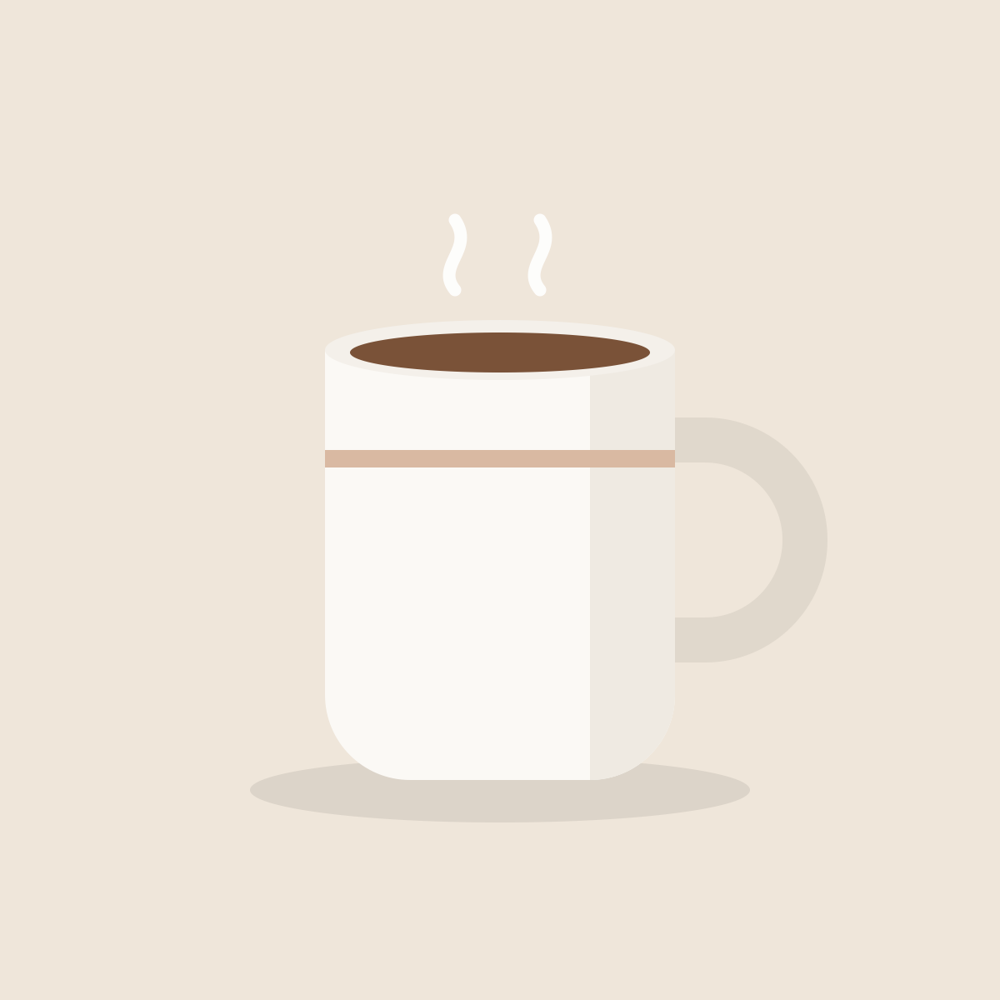
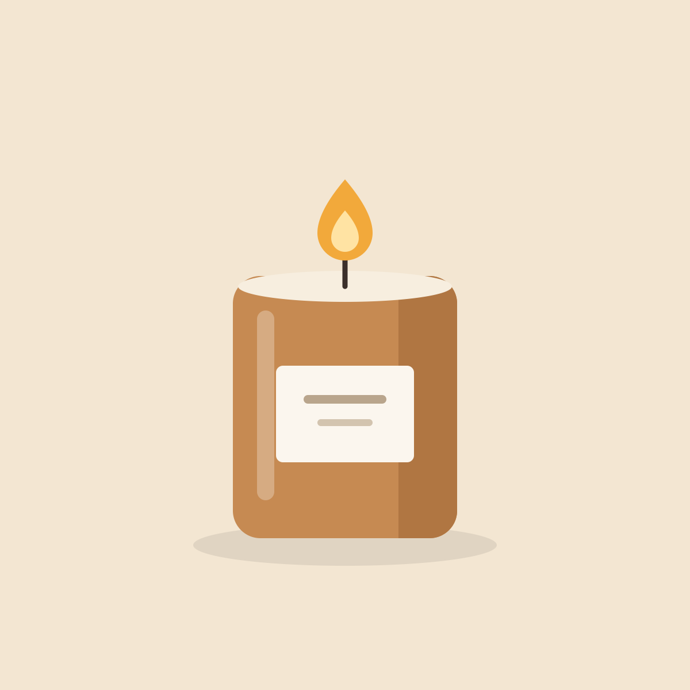
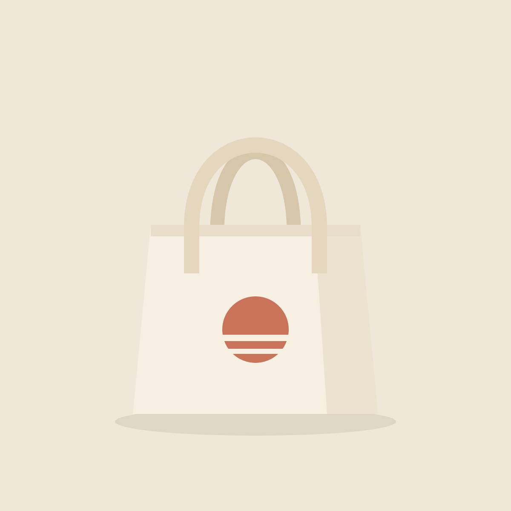
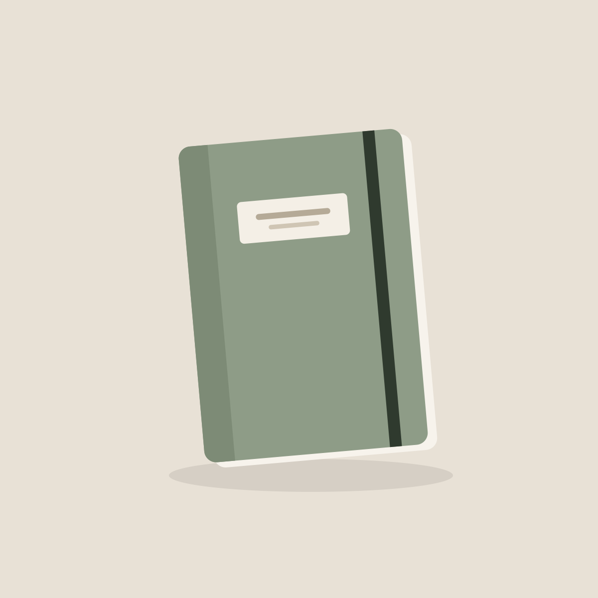
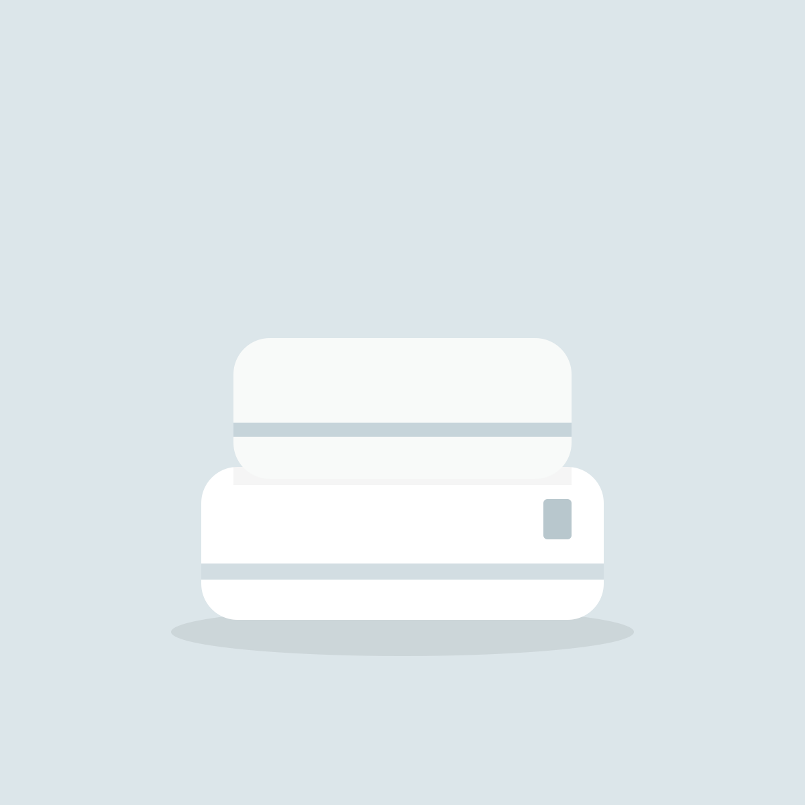

# Maison Claire: products for Shopify

Generated by `tools/make-shopify-sheet.py` from the same data as the demo store (`assets/catalog.js`) and the agent's knowledge base (`docs/kb-delivery.md`), so prices, sizes and delivery promises match what the voice agent says. Edit the script and re-run it rather than editing this file.

**Two ways to load the products**

- **Fastest:** Shopify Admin → **Products** → **Import** → upload [`products_import.csv`](products_import.csv). It creates all 8 products in English with price, cost, SKU, stock, weight, tags, SEO and image. Then add the few fields the CSV can't carry (category, collections, customs, French): see *After the import* below.

- **By hand:** Products → **Add product**, and copy each field from the product cards below. For the description, click the **`<>`** (Show HTML) button in the description editor and paste the HTML block.

Prices include VAT (see *Store settings*). Inventory quantities, cost prices, countries of origin and HS codes are realistic but invented for this demo store.

## Summary

| Product | Handle | SKU | Price | Cost | Stock | Shipping weight |
| --- | --- | --- | ---: | ---: | ---: | ---: |
| Ceramic Mug | `ceramic-mug` | `MC-MUG-350-WHT` | 18 € | 6.00 € | 120 | 0.55 kg |
| Vanilla Scented Candle | `vanilla-scented-candle` | `MC-CND-200-VAN` | 24 € | 8.00 € | 80 | 0.45 kg |
| Wool Blanket | `wool-blanket` | `MC-BLK-130170-BEI` | 79 € | 31.00 € | 25 | 1.2 kg |
| Insulated Bottle | `insulated-bottle` | `MC-BTL-500-BLU` | 29 € | 11.00 € | 60 | 0.45 kg |
| Cotton Tote Bag | `cotton-tote-bag` | `MC-TOT-3842-NAT` | 15 € | 4.50 € | 150 | 0.25 kg |
| Paper Notebook | `paper-notebook` | `MC-NTB-A5-SGE` | 12 € | 3.80 € | 200 | 0.35 kg |
| Cotton Bath Towel | `cotton-bath-towel` | `MC-TWL-70140-WHT` | 25 € | 9.00 € | 70 | 0.65 kg |
| Table Lamp | `table-lamp` | `MC-LMP-40-TER` | 69 € | 26.00 € | 15 | 2.6 kg |

## 1. Ceramic Mug / Tasse en céramique



**Main fields** (Add product page, top to bottom)

| Field | Value |
| --- | --- |
| Title | Ceramic Mug |
| Description | HTML block below |
| Media | `shopify/images/maison-claire-mug.png`, alt text: White stoneware ceramic mug filled with coffee |
| Category | search **Mugs** (Home & Garden > Kitchen & Dining > Tableware > Drinkware > Mugs) |
| Price | 18.00 € |
| Compare-at price | leave empty (the agent's offer is the MERCI10 code) |
| Charge tax on this product | Yes |
| Cost per item | 6.00 € |
| Track quantity | Yes |
| Quantity | 120 |
| Continue selling when out of stock | No |
| SKU | MC-MUG-350-WHT |
| Barcode | leave empty |
| This is a physical product | Yes |
| Weight (with packaging) | 0.55 kg |
| Country/Region of origin | Portugal |
| HS code | 6912.00 |
| Variants | none (one version only) |
| Status | Active |
| Sales channels | Online Store |
| Type | Mugs |
| Vendor | Maison Claire |
| Collections | Kitchen & Table, Gifts under 30 € |
| Tags | ceramic, stoneware, kitchen, dishwasher safe, gift under 30 |
| Page title (SEO) | Ceramic Mug 350 ml, White Stoneware | Maison Claire |
| Meta description (SEO) | A large white stoneware mug for coffee or tea, 350 ml. Microwave and dishwasher safe. Free delivery from 50 €. |
| URL handle | ceramic-mug |

**Description (English, HTML)**

```html
<p>A generous everyday mug in soft white stoneware.</p>
<p>Glazed stoneware with a smooth, comfortable handle. Holds a large coffee or tea. Microwave and dishwasher safe.</p>
<ul><li><strong>Material:</strong> Stoneware ceramic</li><li><strong>Capacity:</strong> 350 ml</li><li><strong>Colour:</strong> White</li><li><strong>Care:</strong> Dishwasher and microwave safe</li></ul>
<p><em>Ships within 1 to 2 business days. Free delivery from 50 €, otherwise 5 €. Free returns within 30 days.</em></p>
```

**French translation** (Settings → Languages → French → Translate, or the Translate & Adapt app)

| Field | Valeur |
| --- | --- |
| Title | Tasse en céramique |
| Page title (SEO) | Tasse en céramique 350 ml, grès blanc | Maison Claire |
| Meta description (SEO) | Une grande tasse en grès blanc pour le café ou le thé, 350 ml. Micro-ondes et lave-vaisselle. Livraison offerte dès 50 €. |
| Image alt text | Tasse en grès blanc remplie de café |
| Type | Tasses |

```html
<p>Une grande tasse du quotidien en grès blanc.</p>
<p>Grès émaillé avec une anse douce et confortable. Parfaite pour un grand café ou un thé. Compatible micro-ondes et lave-vaisselle.</p>
<ul><li><strong>Matière :</strong> Grès céramique</li><li><strong>Contenance :</strong> 350 ml</li><li><strong>Couleur :</strong> Blanc</li><li><strong>Entretien :</strong> Lave-vaisselle et micro-ondes</li></ul>
<p><em>Expédié sous 1 à 2 jours ouvrés. Livraison offerte dès 50 €, sinon 5 €. Retours gratuits sous 30 jours.</em></p>
```

## 2. Vanilla Scented Candle / Bougie parfumée à la vanille



**Main fields** (Add product page, top to bottom)

| Field | Value |
| --- | --- |
| Title | Vanilla Scented Candle |
| Description | HTML block below |
| Media | `shopify/images/maison-claire-candle.png`, alt text: Vanilla candle in an amber glass jar, lit |
| Category | search **Candles** (Home & Garden > Decor > Home Fragrances > Candles) |
| Price | 24.00 € |
| Compare-at price | leave empty (the agent's offer is the MERCI10 code) |
| Charge tax on this product | Yes |
| Cost per item | 8.00 € |
| Track quantity | Yes |
| Quantity | 80 |
| Continue selling when out of stock | No |
| SKU | MC-CND-200-VAN |
| Barcode | leave empty |
| This is a physical product | Yes |
| Weight (with packaging) | 0.45 kg |
| Country/Region of origin | France |
| HS code | 3406.00 |
| Variants | none (one version only) |
| Status | Active |
| Sales channels | Online Store |
| Type | Candles |
| Vendor | Maison Claire |
| Collections | Home & Living, Gifts under 30 € |
| Tags | candle, vanilla, soy wax, home fragrance, gift under 30 |
| Page title (SEO) | Vanilla Scented Soy Candle, 40 Hours | Maison Claire |
| Meta description (SEO) | Soy wax vanilla candle in an amber glass jar, about 40 hours of burn time. A gentle scent for the whole room. |
| URL handle | vanilla-scented-candle |

**Description (English, HTML)**

```html
<p>A warm vanilla candle in an amber glass jar.</p>
<p>Natural soy wax and a cotton wick for a clean, slow burn. A gentle vanilla scent that fills a room without being overpowering.</p>
<ul><li><strong>Wax:</strong> Soy wax, cotton wick</li><li><strong>Burn time:</strong> About 40 hours</li><li><strong>Weight:</strong> 200 g</li><li><strong>Scent:</strong> Vanilla</li><li><strong>Jar:</strong> Amber glass</li></ul>
<p><em>Ships within 1 to 2 business days. Free delivery from 50 €, otherwise 5 €. Free returns within 30 days.</em></p>
```

**French translation** (Settings → Languages → French → Translate, or the Translate & Adapt app)

| Field | Valeur |
| --- | --- |
| Title | Bougie parfumée à la vanille |
| Page title (SEO) | Bougie parfumée vanille, cire de soja, 40 h | Maison Claire |
| Meta description (SEO) | Bougie à la vanille en cire de soja dans un pot en verre ambré, environ 40 heures de combustion. Un parfum doux pour toute la pièce. |
| Image alt text | Bougie à la vanille allumée dans un pot en verre ambré |
| Type | Bougies |

```html
<p>Une bougie à la vanille dans un pot en verre ambré.</p>
<p>Cire de soja naturelle et mèche en coton pour une combustion lente et propre. Un doux parfum de vanille qui embaume la pièce sans être trop fort.</p>
<ul><li><strong>Cire :</strong> Cire de soja, mèche en coton</li><li><strong>Durée :</strong> Environ 40 heures</li><li><strong>Poids :</strong> 200 g</li><li><strong>Parfum :</strong> Vanille</li><li><strong>Pot :</strong> Verre ambré</li></ul>
<p><em>Expédié sous 1 à 2 jours ouvrés. Livraison offerte dès 50 €, sinon 5 €. Retours gratuits sous 30 jours.</em></p>
```

## 3. Wool Blanket / Plaid en laine


**Main fields** (Add product page, top to bottom)

| Field | Value |
| --- | --- |
| Title | Wool Blanket |
| Description | HTML block below |
| Media | `shopify/images/maison-claire-blanket.png`, alt text: Folded natural beige wool blanket with a stripe |
| Category | search **Blankets** (Home & Garden > Linens & Bedding > Bedding > Blankets) |
| Price | 79.00 € |
| Compare-at price | leave empty (the agent's offer is the MERCI10 code) |
| Charge tax on this product | Yes |
| Cost per item | 31.00 € |
| Track quantity | Yes |
| Quantity | 25 |
| Continue selling when out of stock | No |
| SKU | MC-BLK-130170-BEI |
| Barcode | leave empty |
| This is a physical product | Yes |
| Weight (with packaging) | 1.2 kg |
| Country/Region of origin | Portugal |
| HS code | 6301.20 |
| Variants | none (one version only) |
| Status | Active |
| Sales channels | Online Store |
| Type | Blankets |
| Vendor | Maison Claire |
| Collections | Home & Living |
| Tags | wool, blanket, throw, living room, bedroom |
| Page title (SEO) | Pure Wool Blanket 130 × 170 cm, Natural Beige | Maison Claire |
| Meta description (SEO) | A soft, warm pure wool blanket with fringed edges, 130 × 170 cm, for the sofa or the bed. Free delivery from 50 €. |
| URL handle | wool-blanket |

**Description (English, HTML)**

```html
<p>A soft, warm blanket for the sofa or the bed.</p>
<p>Woven from pure wool in a natural beige colour, with a simple stripe and fringed edges. Warm in winter, breathable all year.</p>
<ul><li><strong>Material:</strong> 100% wool</li><li><strong>Size:</strong> 130 × 170 cm</li><li><strong>Colour:</strong> Natural beige</li><li><strong>Care:</strong> Hand wash cold</li></ul>
<p><em>Ships within 1 to 2 business days. Free delivery from 50 €, otherwise 5 €. Free returns within 30 days.</em></p>
```

**French translation** (Settings → Languages → French → Translate, or the Translate & Adapt app)

| Field | Valeur |
| --- | --- |
| Title | Plaid en laine |
| Page title (SEO) | Plaid en pure laine 130 × 170 cm, beige naturel | Maison Claire |
| Meta description (SEO) | Un plaid doux et chaud en pure laine avec franges, 130 × 170 cm, pour le canapé ou le lit. Livraison offerte dès 50 €. |
| Image alt text | Plaid en laine beige naturel plié, avec une rayure |
| Type | Plaids |

```html
<p>Un plaid doux et chaud pour le canapé ou le lit.</p>
<p>Tissé en pure laine beige naturel, avec une rayure simple et des franges. Chaud en hiver, respirant toute l&#x27;année.</p>
<ul><li><strong>Matière :</strong> 100 % laine</li><li><strong>Dimensions :</strong> 130 × 170 cm</li><li><strong>Couleur :</strong> Beige naturel</li><li><strong>Entretien :</strong> Lavage à la main à froid</li></ul>
<p><em>Expédié sous 1 à 2 jours ouvrés. Livraison offerte dès 50 €, sinon 5 €. Retours gratuits sous 30 jours.</em></p>
```

## 4. Insulated Bottle / Gourde isotherme


**Main fields** (Add product page, top to bottom)

| Field | Value |
| --- | --- |
| Title | Insulated Bottle |
| Description | HTML block below |
| Media | `shopify/images/maison-claire-bottle.png`, alt text: Slate blue insulated stainless steel bottle |
| Category | search **Water Bottles** (Home & Garden > Kitchen & Dining > Food & Beverage Carriers > Water Bottles) |
| Price | 29.00 € |
| Compare-at price | leave empty (the agent's offer is the MERCI10 code) |
| Charge tax on this product | Yes |
| Cost per item | 11.00 € |
| Track quantity | Yes |
| Quantity | 60 |
| Continue selling when out of stock | No |
| SKU | MC-BTL-500-BLU |
| Barcode | leave empty |
| This is a physical product | Yes |
| Weight (with packaging) | 0.45 kg |
| Country/Region of origin | China |
| HS code | 9617.00 |
| Variants | none (one version only) |
| Status | Active |
| Sales channels | Online Store |
| Type | Water bottles |
| Vendor | Maison Claire |
| Collections | Kitchen & Table, Gifts under 30 € |
| Tags | bottle, stainless steel, insulated, on the go, gift under 30 |
| Page title (SEO) | Insulated Stainless Steel Bottle 500 ml | Maison Claire |
| Meta description (SEO) | Leak proof 500 ml stainless steel bottle in slate blue. Keeps drinks cold for 24 hours or hot for 12. |
| URL handle | insulated-bottle |

**Description (English, HTML)**

```html
<p>Keeps drinks cold for 24 hours or hot for 12.</p>
<p>Double wall stainless steel with a leak proof cap and a carry loop. Fits most cup holders.</p>
<ul><li><strong>Material:</strong> Double wall stainless steel</li><li><strong>Capacity:</strong> 500 ml</li><li><strong>Colour:</strong> Slate blue</li><li><strong>Keeps:</strong> Cold 24 h, hot 12 h</li><li><strong>Care:</strong> Hand wash</li></ul>
<p><em>Ships within 1 to 2 business days. Free delivery from 50 €, otherwise 5 €. Free returns within 30 days.</em></p>
```

**French translation** (Settings → Languages → French → Translate, or the Translate & Adapt app)

| Field | Valeur |
| --- | --- |
| Title | Gourde isotherme |
| Page title (SEO) | Gourde isotherme inox 500 ml, bleu ardoise | Maison Claire |
| Meta description (SEO) | Gourde étanche en acier inoxydable 500 ml, bleu ardoise. Garde vos boissons froides 24 h ou chaudes 12 h. |
| Image alt text | Gourde isotherme en acier inoxydable bleu ardoise |
| Type | Gourdes |

```html
<p>Garde vos boissons froides 24 h ou chaudes 12 h.</p>
<p>Acier inoxydable double paroi, bouchon étanche et anse de transport. Se glisse dans la plupart des porte-gobelets.</p>
<ul><li><strong>Matière :</strong> Acier inoxydable double paroi</li><li><strong>Contenance :</strong> 500 ml</li><li><strong>Couleur :</strong> Bleu ardoise</li><li><strong>Conservation :</strong> Froid 24 h, chaud 12 h</li><li><strong>Entretien :</strong> Lavage à la main</li></ul>
<p><em>Expédié sous 1 à 2 jours ouvrés. Livraison offerte dès 50 €, sinon 5 €. Retours gratuits sous 30 jours.</em></p>
```

## 5. Cotton Tote Bag / Sac cabas en coton



**Main fields** (Add product page, top to bottom)

| Field | Value |
| --- | --- |
| Title | Cotton Tote Bag |
| Description | HTML block below |
| Media | `shopify/images/maison-claire-tote.png`, alt text: Natural organic cotton tote bag with long handles |
| Category | search **Shopping Totes** (Luggage & Bags > Shopping Totes) |
| Price | 15.00 € |
| Compare-at price | leave empty (the agent's offer is the MERCI10 code) |
| Charge tax on this product | Yes |
| Cost per item | 4.50 € |
| Track quantity | Yes |
| Quantity | 150 |
| Continue selling when out of stock | No |
| SKU | MC-TOT-3842-NAT |
| Barcode | leave empty |
| This is a physical product | Yes |
| Weight (with packaging) | 0.25 kg |
| Country/Region of origin | India |
| HS code | 4202.92 |
| Variants | none (one version only) |
| Status | Active |
| Sales channels | Online Store |
| Type | Tote bags |
| Vendor | Maison Claire |
| Collections | Everyday Essentials, Gifts under 30 € |
| Tags | tote bag, organic cotton, everyday, gift under 30 |
| Page title (SEO) | Organic Cotton Tote Bag 38 × 42 cm | Maison Claire |
| Meta description (SEO) | A sturdy organic cotton tote with long shoulder handles and an inside pocket for keys and phone. |
| URL handle | cotton-tote-bag |

**Description (English, HTML)**

```html
<p>A sturdy everyday bag in organic cotton.</p>
<p>Thick organic cotton canvas with long handles to wear on the shoulder, and an inside pocket for keys and phone.</p>
<ul><li><strong>Material:</strong> Organic cotton canvas</li><li><strong>Size:</strong> 38 × 42 cm</li><li><strong>Colour:</strong> Natural</li><li><strong>Care:</strong> Machine wash 30 °C</li></ul>
<p><em>Ships within 1 to 2 business days. Free delivery from 50 €, otherwise 5 €. Free returns within 30 days.</em></p>
```

**French translation** (Settings → Languages → French → Translate, or the Translate & Adapt app)

| Field | Valeur |
| --- | --- |
| Title | Sac cabas en coton |
| Page title (SEO) | Sac cabas en coton bio 38 × 42 cm | Maison Claire |
| Meta description (SEO) | Un sac cabas robuste en coton bio, longues anses d'épaule et poche intérieure pour les clés et le téléphone. |
| Image alt text | Sac cabas en coton bio écru à longues anses |
| Type | Sacs cabas |

```html
<p>Un sac robuste du quotidien en coton bio.</p>
<p>Toile de coton bio épaisse, longues anses pour le porter à l&#x27;épaule et poche intérieure pour les clés et le téléphone.</p>
<ul><li><strong>Matière :</strong> Toile de coton bio</li><li><strong>Dimensions :</strong> 38 × 42 cm</li><li><strong>Couleur :</strong> Écru</li><li><strong>Entretien :</strong> Machine à 30 °C</li></ul>
<p><em>Expédié sous 1 à 2 jours ouvrés. Livraison offerte dès 50 €, sinon 5 €. Retours gratuits sous 30 jours.</em></p>
```

## 6. Paper Notebook / Carnet de notes



**Main fields** (Add product page, top to bottom)

| Field | Value |
| --- | --- |
| Title | Paper Notebook |
| Description | HTML block below |
| Media | `shopify/images/maison-claire-notebook.png`, alt text: Sage green linen A5 notebook with an elastic band |
| Category | search **Notebooks & Notepads** (Office Supplies > General Office Supplies > Paper Products > Notebooks & Notepads) |
| Price | 12.00 € |
| Compare-at price | leave empty (the agent's offer is the MERCI10 code) |
| Charge tax on this product | Yes |
| Cost per item | 3.80 € |
| Track quantity | Yes |
| Quantity | 200 |
| Continue selling when out of stock | No |
| SKU | MC-NTB-A5-SGE |
| Barcode | leave empty |
| This is a physical product | Yes |
| Weight (with packaging) | 0.35 kg |
| Country/Region of origin | France |
| HS code | 4820.10 |
| Variants | none (one version only) |
| Status | Active |
| Sales channels | Online Store |
| Type | Notebooks |
| Vendor | Maison Claire |
| Collections | Everyday Essentials, Gifts under 30 € |
| Tags | notebook, A5, recycled paper, stationery, gift under 30 |
| Page title (SEO) | A5 Dotted Notebook, Recycled Paper, Linen Cover | Maison Claire |
| Meta description (SEO) | A5 notebook with 160 dotted pages of thick recycled paper, a sage green linen cover and an elastic closure. |
| URL handle | paper-notebook |

**Description (English, HTML)**

```html
<p>A5 notebook with dotted pages and a linen cover.</p>
<p>160 pages of thick recycled paper that lies flat when open, with an elastic band to keep it closed.</p>
<ul><li><strong>Format:</strong> A5</li><li><strong>Pages:</strong> 160 dotted pages</li><li><strong>Paper:</strong> Thick recycled paper</li><li><strong>Cover:</strong> Sage green linen, elastic closure</li></ul>
<p><em>Ships within 1 to 2 business days. Free delivery from 50 €, otherwise 5 €. Free returns within 30 days.</em></p>
```

**French translation** (Settings → Languages → French → Translate, or the Translate & Adapt app)

| Field | Valeur |
| --- | --- |
| Title | Carnet de notes |
| Page title (SEO) | Carnet A5 pointillé, papier recyclé, couverture lin | Maison Claire |
| Meta description (SEO) | Carnet A5 de 160 pages pointillées en papier recyclé épais, couverture en lin vert sauge et élastique de fermeture. |
| Image alt text | Carnet A5 en lin vert sauge avec élastique |
| Type | Carnets |

```html
<p>Carnet A5 à pages pointillées et couverture en lin.</p>
<p>160 pages en papier recyclé épais qui reste bien à plat une fois ouvert, avec un élastique de fermeture.</p>
<ul><li><strong>Format :</strong> A5</li><li><strong>Pages :</strong> 160 pages pointillées</li><li><strong>Papier :</strong> Papier recyclé épais</li><li><strong>Couverture :</strong> Lin vert sauge, élastique de fermeture</li></ul>
<p><em>Expédié sous 1 à 2 jours ouvrés. Livraison offerte dès 50 €, sinon 5 €. Retours gratuits sous 30 jours.</em></p>
```

## 7. Cotton Bath Towel / Serviette de bain en coton



**Main fields** (Add product page, top to bottom)

| Field | Value |
| --- | --- |
| Title | Cotton Bath Towel |
| Description | HTML block below |
| Media | `shopify/images/maison-claire-towel.png`, alt text: Folded white cotton bath towels |
| Category | search **Bath Towels & Washcloths** (Home & Garden > Linens & Bedding > Towels > Bath Towels & Washcloths) |
| Price | 25.00 € |
| Compare-at price | leave empty (the agent's offer is the MERCI10 code) |
| Charge tax on this product | Yes |
| Cost per item | 9.00 € |
| Track quantity | Yes |
| Quantity | 70 |
| Continue selling when out of stock | No |
| SKU | MC-TWL-70140-WHT |
| Barcode | leave empty |
| This is a physical product | Yes |
| Weight (with packaging) | 0.65 kg |
| Country/Region of origin | Portugal |
| HS code | 6302.60 |
| Variants | none (one version only) |
| Status | Active |
| Sales channels | Online Store |
| Type | Bath towels |
| Vendor | Maison Claire |
| Collections | Bath, Gifts under 30 € |
| Tags | towel, cotton, bathroom, gift under 30 |
| Page title (SEO) | White Cotton Bath Towel 70 × 140 cm | Maison Claire |
| Meta description (SEO) | A thick, absorbent 100% cotton bath towel, 70 × 140 cm, that gets softer with every wash. |
| URL handle | cotton-bath-towel |

**Description (English, HTML)**

```html
<p>A thick, absorbent towel in soft white cotton.</p>
<p>Heavy cotton that gets softer with every wash. Large enough to wrap around you after a shower.</p>
<ul><li><strong>Material:</strong> 100% cotton</li><li><strong>Size:</strong> 70 × 140 cm</li><li><strong>Colour:</strong> White</li><li><strong>Care:</strong> Machine wash 40 °C</li></ul>
<p><em>Ships within 1 to 2 business days. Free delivery from 50 €, otherwise 5 €. Free returns within 30 days.</em></p>
```

**French translation** (Settings → Languages → French → Translate, or the Translate & Adapt app)

| Field | Valeur |
| --- | --- |
| Title | Serviette de bain en coton |
| Page title (SEO) | Serviette de bain en coton blanc 70 × 140 cm | Maison Claire |
| Meta description (SEO) | Une serviette de bain épaisse et absorbante, 100 % coton, 70 × 140 cm, plus douce à chaque lavage. |
| Image alt text | Serviettes de bain en coton blanc pliées |
| Type | Serviettes de bain |

```html
<p>Une serviette épaisse et absorbante en coton blanc.</p>
<p>Un coton épais qui devient plus doux à chaque lavage. Assez grande pour s&#x27;envelopper après la douche.</p>
<ul><li><strong>Matière :</strong> 100 % coton</li><li><strong>Dimensions :</strong> 70 × 140 cm</li><li><strong>Couleur :</strong> Blanc</li><li><strong>Entretien :</strong> Machine à 40 °C</li></ul>
<p><em>Expédié sous 1 à 2 jours ouvrés. Livraison offerte dès 50 €, sinon 5 €. Retours gratuits sous 30 jours.</em></p>
```

## 8. Table Lamp / Lampe de table


**Main fields** (Add product page, top to bottom)

| Field | Value |
| --- | --- |
| Title | Table Lamp |
| Description | HTML block below |
| Media | `shopify/images/maison-claire-lamp.png`, alt text: Terracotta ceramic table lamp with a linen shade |
| Category | search **Lamps** (Home & Garden > Lighting > Lamps) |
| Price | 69.00 € |
| Compare-at price | leave empty (the agent's offer is the MERCI10 code) |
| Charge tax on this product | Yes |
| Cost per item | 26.00 € |
| Track quantity | Yes |
| Quantity | 15 |
| Continue selling when out of stock | No |
| SKU | MC-LMP-40-TER |
| Barcode | leave empty |
| This is a physical product | Yes |
| Weight (with packaging) | 2.6 kg |
| Country/Region of origin | Portugal |
| HS code | 9405.21 |
| Variants | none (one version only) |
| Status | Active |
| Sales channels | Online Store |
| Type | Lamps |
| Vendor | Maison Claire |
| Collections | Home & Living |
| Tags | lamp, ceramic, linen, lighting, living room |
| Page title (SEO) | Terracotta Ceramic Table Lamp, Linen Shade | Maison Claire |
| Meta description (SEO) | A 40 cm terracotta ceramic table lamp with a natural linen shade. LED bulb included. Free delivery from 50 €. |
| URL handle | table-lamp |

**Description (English, HTML)**

```html
<p>A ceramic lamp with a linen shade for soft, warm light.</p>
<p>Terracotta ceramic base and natural linen shade. Comes with an LED bulb and an on and off switch on the cable.</p>
<ul><li><strong>Material:</strong> Ceramic base, linen shade</li><li><strong>Height:</strong> 40 cm</li><li><strong>Bulb:</strong> LED bulb included</li><li><strong>Switch:</strong> On and off switch on the cable</li><li><strong>Colour:</strong> Terracotta</li></ul>
<p><em>Ships within 1 to 2 business days. Free delivery from 50 €, otherwise 5 €. Free returns within 30 days.</em></p>
```

**French translation** (Settings → Languages → French → Translate, or the Translate & Adapt app)

| Field | Valeur |
| --- | --- |
| Title | Lampe de table |
| Page title (SEO) | Lampe de table céramique terracotta, abat-jour lin | Maison Claire |
| Meta description (SEO) | Lampe de table de 40 cm en céramique terracotta avec abat-jour en lin naturel. Ampoule LED incluse. Livraison offerte dès 50 €. |
| Image alt text | Lampe de table en céramique terracotta avec abat-jour en lin |
| Type | Lampes |

```html
<p>Une lampe en céramique avec abat-jour en lin pour une lumière douce.</p>
<p>Pied en céramique terracotta et abat-jour en lin naturel. Livrée avec une ampoule LED et un interrupteur sur le câble.</p>
<ul><li><strong>Matière :</strong> Pied en céramique, abat-jour en lin</li><li><strong>Hauteur :</strong> 40 cm</li><li><strong>Ampoule :</strong> Ampoule LED incluse</li><li><strong>Interrupteur :</strong> Sur le câble</li><li><strong>Couleur :</strong> Terracotta</li></ul>
<p><em>Expédié sous 1 à 2 jours ouvrés. Livraison offerte dès 50 €, sinon 5 €. Retours gratuits sous 30 jours.</em></p>
```

## After the import

The Shopify CSV has no columns for these, so set them once per product (or in bulk: select the products → **Bulk edit**):

1. **Category**: open each product, type the search word from its card into *Category*.
2. **Customs**: *Country/Region of origin* and *HS code*, in the Shipping section of each product (needed for the UK and Switzerland).
3. **Collections**: create these five manual collections (Products → Collections → Create collection), then add the products:

| Collection (EN) | Collection (FR) | Products |
| --- | --- | --- |
| Kitchen & Table | Cuisine et table | Ceramic Mug, Insulated Bottle |
| Home & Living | Maison et déco | Vanilla Scented Candle, Wool Blanket, Table Lamp |
| Bath | Salle de bain | Cotton Bath Towel |
| Everyday Essentials | Essentiels du quotidien | Cotton Tote Bag, Paper Notebook |
| Gifts under 30 € | Cadeaux à moins de 30 € | Ceramic Mug, Vanilla Scented Candle, Insulated Bottle, Cotton Tote Bag, Paper Notebook, Cotton Bath Towel |

4. **French**: paste the French title, description and SEO fields from each card.

## Shipping (Settings → Shipping and delivery)

These rates match the agent's knowledge base: dispatch in 1 to 2 business days, 5 € delivery, free from 50 €, tracked standard delivery only.

In **General shipping rates**, create three zones. Give each zone the same two rates (*Add rate* → *Use flat rate*, then *Custom delivery description*):

| Zone | Countries | Rate 1 (orders under 50 €) | Rate 2 (orders from 50 €) | Delivery description |
| --- | --- | --- | --- | --- |
| France | France (mainland and Corsica) | Standard tracked delivery: 5.00 €, condition *Based on order price* max 49.99 € | Free standard delivery: 0.00 €, condition min 50.00 € | 3 to 6 business days (Corsica 5 to 8) |
| Europe | Belgium, Luxembourg, Germany, Netherlands, Spain, Italy, Ireland | same | same | 4 to 7 business days |
| UK and Switzerland | United Kingdom, Switzerland | same | same | 5 to 8 business days. Import taxes may be charged on delivery |

French rate names: *Livraison standard suivie* / *Livraison offerte*. Delivery descriptions: *3 à 6 jours ouvrés (Corse : 5 à 8)*, *4 à 7 jours ouvrés*, *5 à 8 jours ouvrés. Des taxes d'importation peuvent être demandées à la livraison.*

Don't add the French overseas territories (Guadeloupe, Martinique, Réunion…): the store doesn't deliver there.

**Packages** (Shipping and delivery → Packages): set a default box of 30 × 25 × 15 cm, and add a large box of 45 × 35 × 35 cm for the lamp. Product weights above already include packaging.

**Shipping policy** (Settings → Policies → Shipping policy):

```text
Orders leave our warehouse within 1 to 2 business days. Delivery times from order to door: mainland France 3 to 6 business days; Belgium, Luxembourg, Germany, the Netherlands, Spain, Italy and Ireland 4 to 7 business days; United Kingdom and Switzerland 5 to 8 business days (local import taxes may be charged on delivery); Corsica 5 to 8 business days. We do not deliver to the French overseas territories yet.

Delivery is free from 50 euros, otherwise 5 euros. All orders go by tracked standard delivery; you receive an email and a text message with a tracking link when your parcel leaves. If you are not home, the carrier leaves your parcel at a nearby pickup point for 10 days.

During busy periods (late November to Christmas, sales) please allow 1 to 2 extra business days. If your parcel is more than 3 business days late, contact us through the contact form: we will investigate with the carrier and send a replacement or a full refund.
```

```text
Les commandes quittent notre entrepôt sous 1 à 2 jours ouvrés. Délais entre la commande et la livraison : France métropolitaine 3 à 6 jours ouvrés ; Belgique, Luxembourg, Allemagne, Pays-Bas, Espagne, Italie et Irlande 4 à 7 jours ouvrés ; Royaume-Uni et Suisse 5 à 8 jours ouvrés (des taxes d'importation locales peuvent être demandées à la livraison) ; Corse 5 à 8 jours ouvrés. Nous ne livrons pas encore les départements et territoires d'outre-mer.

La livraison est offerte dès 50 euros, sinon elle coûte 5 euros. Toutes les commandes partent en livraison standard suivie ; vous recevez un e-mail et un SMS avec un lien de suivi au départ du colis. En cas d'absence, le transporteur dépose le colis dans un point relais proche, où il est gardé 10 jours.

En période chargée (de fin novembre à Noël, soldes), comptez 1 à 2 jours ouvrés de plus. Si votre colis a plus de 3 jours ouvrés de retard, contactez-nous via le formulaire de contact : nous ouvrons une enquête auprès du transporteur et envoyons un remplacement ou un remboursement complet.
```

## Store settings the agent relies on

| Where | Setting |
| --- | --- |
| Settings → Taxes and duties | **Include sales tax in product price and shipping rate**: on (prices are VAT-inclusive, as the agent says them). France: collect VAT. |
| Settings → Markets | Primary market France, plus a Europe market (the 7 countries above) and UK/Switzerland. Currency EUR. |
| Settings → Languages | Add French and publish it. |
| Discounts → Create discount → Amount off order | Code **MERCI10**, 10% off the entire order, one use per customer. This is the offer the agent makes on the call. |
| Settings → Policies → Refund policy | Free returns within 30 days of delivery for unused items, prepaid label from the contact form, refund to the original payment method within 5 business days of receiving the parcel. |
| Settings → Checkout → Abandoned checkouts | Turn off Shopify's own abandoned-checkout email during the demo, so the call is the only follow-up. |
